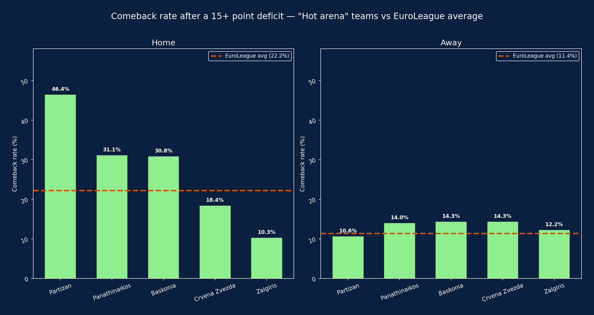

# Hot Arenas, Big Deficits: Does Crowd Intensity Predict Comebacks?

An extension of a Baskonia-focused analysis to five EuroLeague teams known for intense home crowds — Baskonia, Žalgiris, Panathinaikos, Partizan, and Crvena Zvezda — testing whether reputation matches the data.

## Method

Using play-by-play data, for each team and each game: find the worst deficit faced at any point, keep only games where it was **15+ points**, and check whether the team tied or took the lead at any point afterward ("comeback rate"). Compared home vs away, and against the EuroLeague average.

## Results

| Team | Home rate | Away rate | Home − League avg (22.2%) |
|---|---|---|---|
| Partizan | 46.4% | 10.6% | +24.2 |
| Panathinaikos | 31.1% | 14.0% | +8.9 |
| Baskonia | 30.8% | 14.3% | +8.6 |
| Crvena Zvezda | 18.4% | 14.3% | −3.8 |
| Zalgiris | 10.3% | 12.2% | −11.9 |

Three of five teams beat the league average at home; two don't. **Zalgiris is the only team where the home rate is lower than its away rate** — the opposite of the hypothesis, and a contrast with its own strong home advantage in effort stats (rebounds, blocks) found in a separate analysis.

## Checking the "Hot Arena" Premise Against Attendance

Partizan and Crvena Zvezda are, independently of this analysis, EuroLeague's best-attended teams (~19-20K and ~19K per game, both near 95-99% arena capacity) — their reputation is well-supported. Zalgiris also runs near capacity (~97%). **Baskonia is the outlier**: despite the second-strongest home comeback effect, its fill rate (~70%) is close to the EuroLeague average, not exceptional — suggesting its effect, if real, isn't simply about crowd size. For context, Fenerbahçe and Anadolu Efes — often assumed to have loud arenas too — don't rank among EuroLeague's best-attended teams, at roughly 75-80% capacity.

*(Attendance figures are approximate, mostly from the 2023-24 season, sourced from EuroLeague recaps and independent reporting.)*

## Limitations

- **Correlational, not causal**: a higher home comeback rate could reflect crowd energy, team quality, or other factors this analysis can't separate.
- **Uneven sample sizes**: Partizan (11 seasons) and Crvena Zvezda (12) have shorter EuroLeague histories than Panathinaikos, Baskonia, and Zalgiris (19 each) — both due to real competition-eligibility gaps (EuroCup years), not missing data. Partizan's standout number is based on the smallest sample (28 home games).
- **No formal significance testing was run here.** A related analysis on Baskonia alone found the home/away gap did not reach conventional statistical significance (z-test and Fisher's exact test, p > 0.1) despite a similar effect size — the same caution likely applies to these results.
- The "hot arena" list itself was chosen by reputation, not a systematic metric.

## Takeaways

- The "hot arena" premise only partly holds: 3 of 5 reputationally loud teams show a real home advantage in comebacks, 2 don't.
- Partizan and Crvena Zvezda's reputations are backed by genuinely exceptional attendance; Baskonia's strong effect is *not* obviously explained by crowd size.
- Zalgiris shows the opposite pattern from what's expected, despite a clear home advantage in other "effort" stats — a reminder that different home-advantage metrics don't always agree.

## How to Reproduce

1. Download the [Euroleague & Eurocup Datasets](https://www.kaggle.com/datasets/babissamothrakis/euroleague-datasets) from Kaggle
2. Place `euroleague_header.csv` and `euroleague_play_by_play.csv` in a `csv_euroleague` folder
3. Run the analysis script (requires `pandas`, `matplotlib`)

## About

This project combines a background in basketball coaching (8 years) with data analysis.
